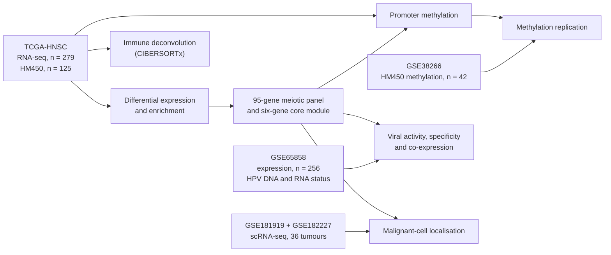
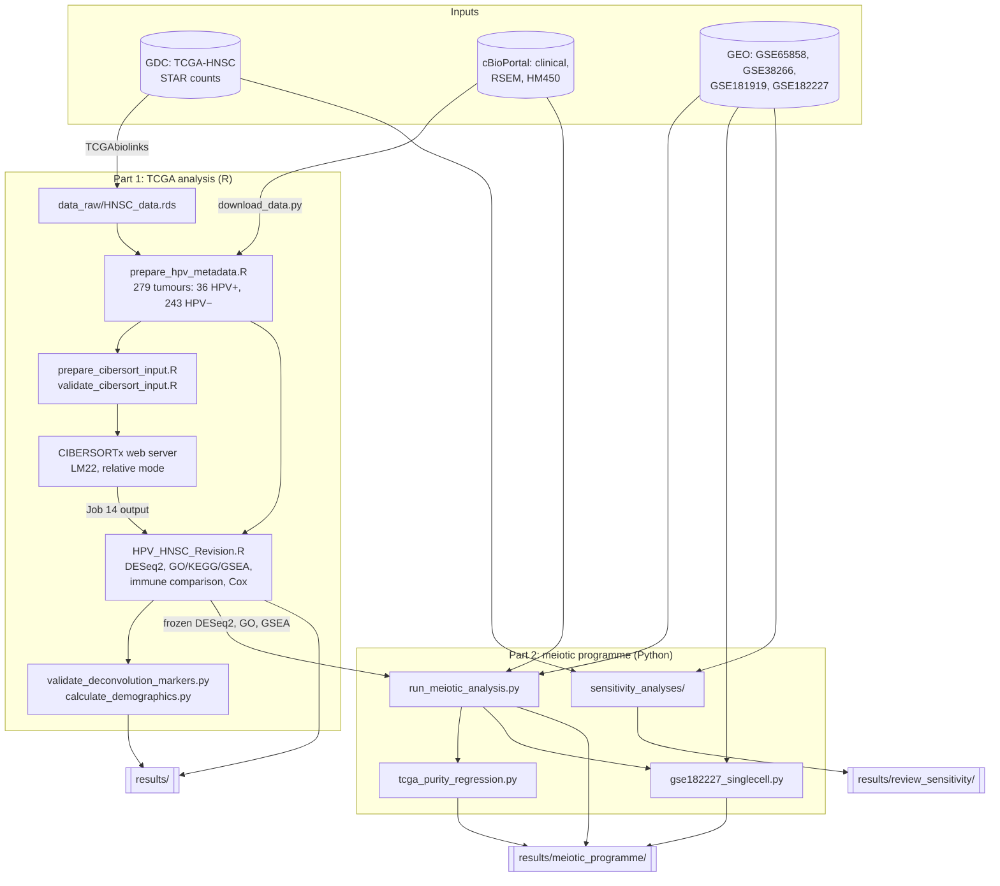
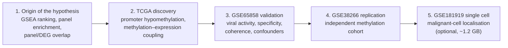

# Transcriptionally active HPV-positive HNSCC: meiotic gene programme, promoter hypomethylation and immune context

Code, processed data and results for the study **“Transcriptionally active HPV-positive head and neck squamous cell carcinoma is associated with a coordinated meiotic gene programme and promoter hypomethylation.”**

## Contents

1. [Summary of findings](#summary-of-findings)
2. [Study design](#study-design)
3. [Repository structure](#repository-structure)
4. [Analysis workflow](#analysis-workflow)
5. [Reproducing the analyses](#reproducing-the-analyses)
6. [Outputs](#outputs)
7. [Software](#software)
8. [Data sources](#data-sources)
9. [License](#license)

## Summary of findings

- **Meiotic programme.** Of 4,744 genes differentially expressed between HPV+ (n = 36) and HPV− (n = 243) TCGA-HNSC primary tumours, six of the twelve most significant are meiotic. Meiotic gene categories, but not the classic MAGE/CTAG cancer–testis antigens, are enriched among HPV+-upregulated genes.
- **Methylation and viral activity.** Meiotic promoters are hypomethylated in HPV+ tumours, in step with expression. A six-gene core score (MEI1, SMC1B, STAG3, SYCP2, SYCE2, MAJIN) separates transcriptionally active HPV+ tumours from HPV− tumours (AUC 0.959), whereas HPV DNA-positive, transcriptionally silent tumours do not differ.
- **Immune microenvironment.** CIBERSORTx (LM22; Benjamini–Hochberg across all 22 populations) shows higher plasma-cell and CD8+ T-cell fractions and lower M0 macrophage, resting NK-cell and resting CD4+ memory T-cell fractions in HPV+ tumours.
- **Malignant-cell localisation.** In two single-cell cohorts, the meiotic signal is confined to malignant cells.
- **Keratinisation.** Keratinisation and epithelial-differentiation programmes are reduced in HPV+ tumours.
- **Survival (exploratory).** Univariable Cox models link higher expression of leading HPV-associated genes to longer overall survival. These models are unadjusted for HPV status or other covariates.

## Study design

Five public cohorts are used. TCGA-HNSC is the discovery cohort; the other four test the findings independently.



## Repository structure

```text
├── LICENSE                                MIT license
├── requirements.txt                       Python dependencies
├── scripts/
│   ├── download_data.py                   cBioPortal clinical files
│   ├── prepare_hpv_metadata.R             cohort definition and HPV status (279 tumours)
│   ├── prepare_cibersort_input.R          TPM mixture matrix for CIBERSORTx
│   ├── validate_cibersort_input.R         checks on the mixture matrix
│   ├── HPV_HNSC_Revision.R                DESeq2, GO/KEGG/GSEA, immune comparison, survival
│   ├── validate_deconvolution_markers.py  deconvolution marker validation
│   ├── calculate_demographics.py          clinical characteristics (Table 1)
│   ├── meiotic_programme/                 panel, methylation, GSE65858, GSE38266, GSE181919, GSE182227
│   └── sensitivity_analyses/              confidence intervals, null models, promoter definition, B/plasma and HPV-definition checks
├── data_raw/                              cBioPortal clinical files, GDC manifest, ABSOLUTE purity calls
├── data_processed/                        HPV status, CIBERSORTx input and Job 14 output
│   └── meiotic_programme/                 95-gene panel (cta_geneset.csv) and frozen enrichment inputs
└── results/                               analysis outputs (see Outputs)
```

## Analysis workflow

The analysis has two parts. The TCGA part (R) needs the TCGA count object, which is not stored here because of its size. The meiotic-programme part (Python) starts from the archived files in `data_processed/` and downloads the public GEO and cBioPortal data it needs.



`run_meiotic_analysis.py` runs five stages in a fixed order:



## Reproducing the analyses

Run all commands from the repository root.

### 1. Data

Clinical annotations (cBioPortal, `hnsc_tcga_pub` and `hnsc_tcga`):

```bash
python scripts/download_data.py
```

**Required input that is not in the repository:** the RNA-seq count object `data_raw/HNSC_data.rds` (GDC, TCGA-HNSC, STAR – Counts). It is too large to deposit and must be rebuilt with the code below before `prepare_hpv_metadata.R`, `prepare_cibersort_input.R`, `validate_cibersort_input.R` and `HPV_HNSC_Revision.R` can run. The archived outputs of those scripts (`data_processed/`, `results/`) can be used without it.

```r
library(TCGAbiolinks)
query <- GDCquery(project = "TCGA-HNSC", data.category = "Transcriptome Profiling",
                  data.type = "Gene Expression Quantification", workflow.type = "STAR - Counts")
GDCdownload(query)
saveRDS(GDCprepare(query), "data_raw/HNSC_data.rds")
```

### 2. Cohort and immune deconvolution

```r
source("scripts/prepare_hpv_metadata.R")      # 279 primary tumours: 36 HPV+, 243 HPV−
source("scripts/prepare_cibersort_input.R")   # data_processed/HNSC_CIBERSORT_Input_Final.txt
source("scripts/validate_cibersort_input.R")
```

The mixture matrix was run on the CIBERSORTx web server (LM22, relative mode, 100 permutations, quantile normalisation disabled, no batch correction). This step cannot be scripted; the archived output is `data_processed/CIBERSORTx_Job14_Results.csv`.

### 3. Main TCGA analysis

```r
source("scripts/HPV_HNSC_Revision.R")
```

This runs DESeq2 (HPV status, with a primary-site sensitivity model), GO/KEGG over-representation and GO-BP GSEA, immune-fraction comparisons across all 22 LM22 populations, the CD8/M2 ratio and marker validation, and exploratory univariable Cox models. Then:

```bash
python scripts/validate_deconvolution_markers.py
python scripts/calculate_demographics.py
```

### 4. Meiotic programme: panel, methylation, external cohorts and single cell

```bash
pip install -r scripts/meiotic_programme/requirements.txt
python scripts/meiotic_programme/make_figure1_deg.py --panels                  # volcano, lollipop and GO-bar panels
python scripts/meiotic_programme/run_meiotic_analysis.py --data DATA/meiotic --panels
python scripts/meiotic_programme/tcga_purity_regression.py                       # purity / proliferation models
python scripts/meiotic_programme/gse182227_singlecell.py --data DATA/meiotic --panels
```

Public data are downloaded into `DATA/meiotic` (outside the repository). GSE181919 is about 1.2 GB; use `--skip-singlecell` to omit it. Outputs go to `results/meiotic_programme/`. With `--panels`, each figure is also exported as 600 dpi single-panel files in `figures/source_panels_600dpi/`, which the scripts create.

| Module (`scripts/meiotic_programme/meiotic/`) | Content |
|---|---|
| `config.py` | 95-gene panel (7 categories), core-6 module, constants, seed |
| `data_tcga.py`, `data_geo.py` | cBioPortal and GEO loaders |
| `enrichment_provenance.py` | GSEA / GO / panel-overlap re-test |
| `tcga_discovery.py` | TCGA promoter methylation |
| `gse65858_validation.py` | viral activity, specificity, coherence, confounders |
| `gse38266_replication.py` | independent methylation replication |
| `gse181919_singlecell.py`, `sc_scoring.py` | single-cell analysis and Tirosh module scoring |
| `figures.py`, `fig_gse182227.py`, `panel_export.py` | figure builders and 600 dpi per-panel export |

`tcga_purity_regression.py` repeats the purity and proliferation models with ABSOLUTE purity calls (`data_raw/TCGA_mastercalls.abs_tables_JSedit.fixed.txt`, the public PanCancer Atlas file from the GDC; the script gives the download address) and writes `results/meiotic_programme/purity/`. The GSE65858 coherence permutation nulls use 1,000 size-matched draws with seed 123 in both `gse65858_validation.py` and `scripts/sensitivity_analyses/gse65858_stats.py`, so both give P = 0.001 (95% null interval 0.027–0.273). In the single-cell stage MAJIN is resolved to its deposited symbol C11orf85, and all Mann–Whitney tests are two-sided (exact at tumour level).

`gse182227_singlecell.py` annotates GSE182227 from scratch (Leiden clustering, marker lineages, inferred-CNV malignant calls), scores malignant cells and fits the pooled two-cohort per-tumour models with proliferation adjustment. The enrichment inputs in `data_processed/meiotic_programme/` are frozen copies of the outputs the reported numbers were computed from; regenerated GO/GSEA outputs in `results/` can differ slightly.

### 5. Sensitivity analyses

These analyses download public data (GEO, cBioPortal, GDC) into a working folder `DATA` (outside the repository) and write their results to `results/review_sensitivity/`, which the scripts create. Place `GSE65858_series_matrix.txt.gz`, `GPL10558.annot.gz`, `GSE38266_series_matrix.txt.gz` (GEO) and `HM450.hg38.manifest.gencode.v36.tsv.gz` (zhou-lab/InfiniumAnnotationV1) in `DATA/geo` first.

```bash
python scripts/sensitivity_analyses/gse65858_prep.py DATA/geo
python scripts/sensitivity_analyses/gse65858_stats.py DATA/geo results/review_sensitivity/GSE65858_core_module_CIs_and_nulls.json
python scripts/sensitivity_analyses/tcga_fetch.py DATA
python scripts/sensitivity_analyses/core_probes_and_gse38266.py DATA
python scripts/sensitivity_analyses/gdc_fetch.py DATA data_raw          # about 1.6 GB of GDC HM450 files
python scripts/sensitivity_analyses/tcga_methylation_sensitivity.py DATA .
python scripts/sensitivity_analyses/gse182227_auc_ci.py results/review_sensitivity/GSE182227_AUC_CI.json
python scripts/sensitivity_analyses/km_zfr2_counts.py . DATA/km   # GDC STAR counts -> ZFR2 survival and CD8 validation inputs (about 1 GB)
```

## Outputs

| Location | Content |
|---|---|
| `results/HNSC_Final_Cohort.csv`, `HNSC_Cohort_Manifest.csv`, `HNSC_Sample_Inclusion_Manifest.csv`, `Cohort_Filtering_Summary.csv` | cohort definition and sample filtering |
| `results/HNSC_DESeq2_*.csv`, `HNSC_HPV_DEGs_annotated.csv` | differential expression, unadjusted and adjusted for primary site |
| `results/HNSC_HPV_GO_*.csv`, `HNSC_HPV_KEGG_*.csv`, `HNSC_HPV_GSEA.csv`, `HNSC_GSEA_GeneRanking.csv` | GO/KEGG over-representation and GSEA |
| `results/HNSC_HPV_Immune_Comparison*.csv`, `HNSC_HPV_Significant_Immune_Cells.csv`, `HNSC_CD8_M2_ratio_data.csv` | CIBERSORTx comparisons between HPV groups |
| `results/CIBERSORTx_*.txt`, `Deconvolution_Marker_Validation.csv` | CIBERSORTx run settings and marker-gene validation |
| `results/HNSC_Survival_Results.csv`, `HNSC_Standardized_Cox_Results.csv` | exploratory Cox models |
| `results/sessionInfo.txt`, `package_versions.csv`, `HNSC_GSEA_package_versions.txt` | R session and package versions |
| `results/meiotic_programme/table*.csv` | panel, methylation, validation, co-expression and confounder tables |
| `results/meiotic_programme/sc_*.csv`, `sc_values.json` | GSE181919 single-cell results |
| `results/meiotic_programme/fig*.png`, `fig*.pdf` | figures from `run_meiotic_analysis.py` |
| `results/meiotic_programme/headline_values.json`, `provenance_values.json` | key reported values |
| `results/meiotic_programme/purity/` | tumour-purity models |

## Software

R 4.6.0 with Bioconductor 3.23: DESeq2 1.52.0, clusterProfiler 4.20.0, enrichplot 1.32.0, org.Hs.eg.db 3.23.1, TCGAbiolinks 2.40.0 and survival 3.8.6. Full versions are in `results/sessionInfo.txt` and `results/package_versions.csv`.

Python 3.11: install with `pip install -r requirements.txt` (numpy, pandas, scipy, matplotlib, Pillow, statsmodels, scikit-learn, requests, python-igraph, leidenalg, umap-learn, scanpy and anndata). `scripts/meiotic_programme/requirements.txt` lists the subset needed for the meiotic-programme and single-cell analyses.

## Data sources

- TCGA-HNSC RNA-seq: [Genomic Data Commons](https://portal.gdc.cancer.gov/projects/TCGA-HNSC)
- Clinical and HPV annotations: [cBioPortal](https://www.cbioportal.org/) (`hnsc_tcga_pub`, `hnsc_tcga`)
- GEO: [GSE65858](https://www.ncbi.nlm.nih.gov/geo/query/acc.cgi?acc=GSE65858), [GSE38266](https://www.ncbi.nlm.nih.gov/geo/query/acc.cgi?acc=GSE38266), [GSE181919](https://www.ncbi.nlm.nih.gov/geo/query/acc.cgi?acc=GSE181919), [GSE182227](https://www.ncbi.nlm.nih.gov/geo/query/acc.cgi?acc=GSE182227)

## License

Code is released under the MIT license (see `LICENSE`).
